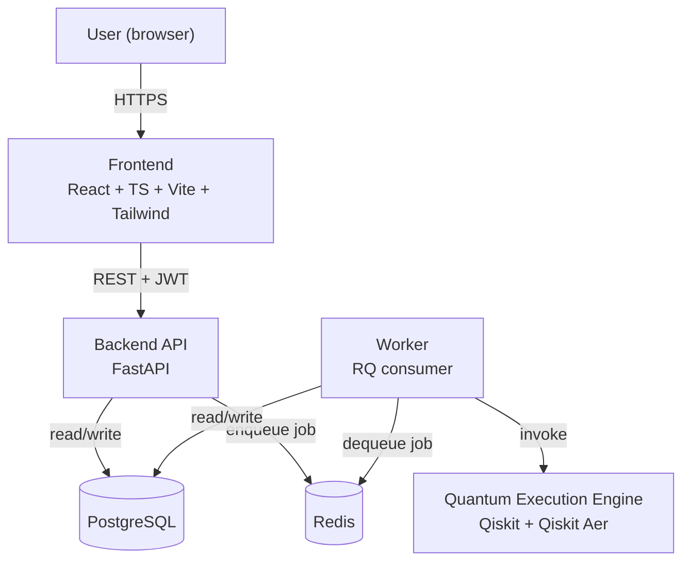
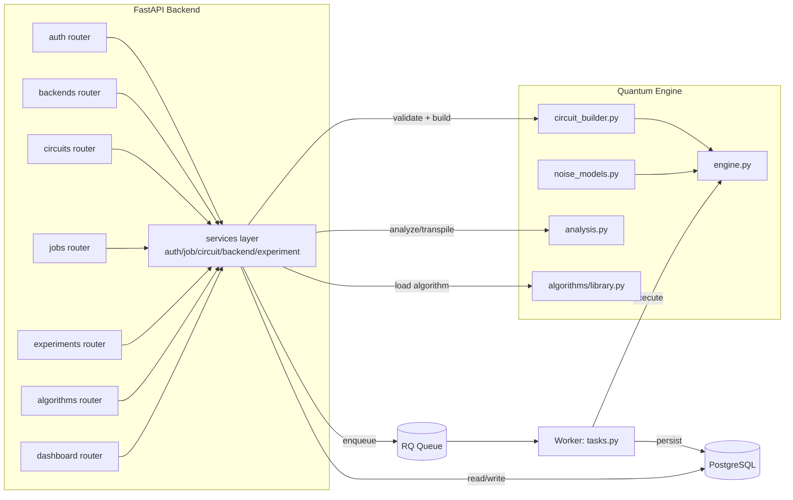
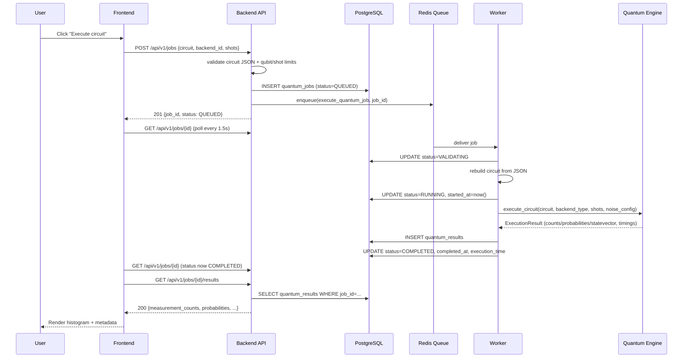
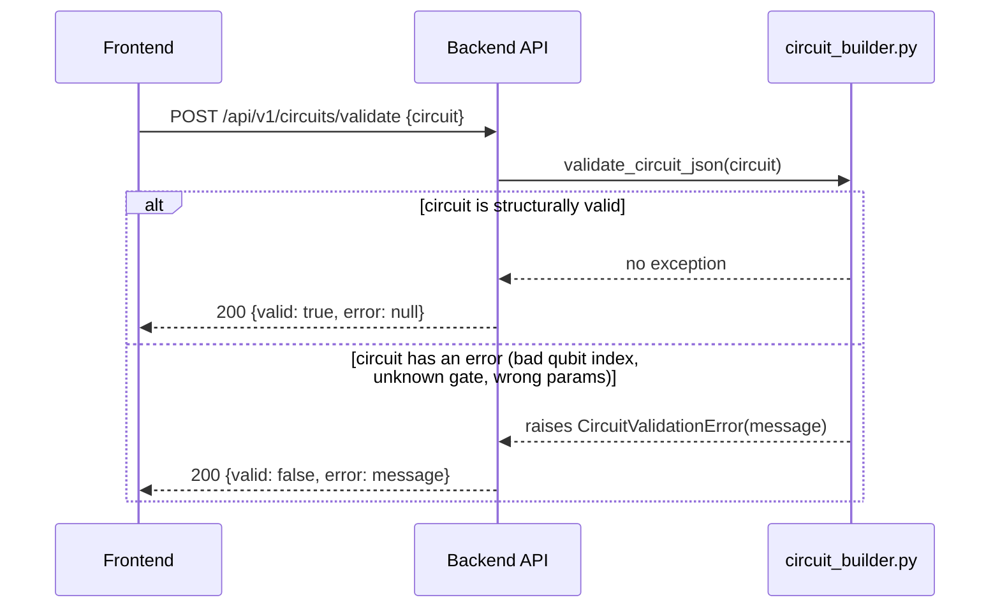
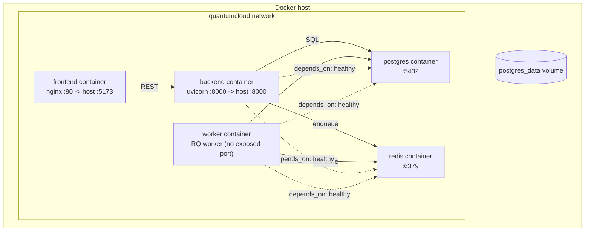

# ARCHITECTURE.md — QuantumCloud Technical Architecture

## 1. Component Responsibilities

| Component | Technology | Responsibility | What it must NOT do |
|---|---|---|---|
| **Frontend** | React 19 + TypeScript + Vite + Tailwind CSS 4 | Render UI, collect user input (circuit, backend, noise config), call the REST API, poll job status, render charts/exports | Never calls Qiskit directly; never trusts client-side validation alone (server re-validates everything) |
| **Backend (API process)** | FastAPI + Pydantic + SQLAlchemy | Authenticate requests, validate input, read/write PostgreSQL, enqueue jobs, serve the public backend/algorithm catalog | Never executes a quantum circuit synchronously in a request handler |
| **Worker process** | Python (RQ consumer) | Dequeue jobs, re-validate, invoke the Quantum Execution Engine, persist results, manage job status transitions | Never accepts direct user input — only ever acts on a `job_id` already created by the API |
| **Quantum Execution Engine** | Qiskit + Qiskit Aer | Build circuits from validated JSON, transpile against a coupling map, run on the selected simulator backend, compute resource/noise diagnostics | Never talks to the database or HTTP layer directly — it is a pure function of (circuit, backend_type, shots, noise_config) → `ExecutionResult` |
| **PostgreSQL** | Postgres 16 | System of record: users, jobs, results, backends, experiments, experiment runs | Never holds unbounded statevector blobs (size-limited, see DATABASE_DESIGN.md) |
| **Redis** | Redis 7 | Job queue transport for RQ; rate-limit counters | Never stores anything that must survive a flush — it is a queue/cache, not a database |
| **Docker / Compose** | Docker Compose v2 | Reproducible multi-service deployment, health-checked startup ordering | Not responsible for production-grade orchestration (no auto-scaling, no rolling deploys) — that is explicitly out of scope for this prototype |

## 2. High-Level Architecture

## 3. Component Architecture

## 4. Quantum Job Execution Sequence

## 5. Circuit Submission (Validation) Sequence

## 6. Deployment Architecture

- Each service has a Docker `HEALTHCHECK` (backend: `curl /health`;
  frontend: `wget` against nginx; postgres: `pg_isready`; redis:
  `redis-cli ping`), and `depends_on: condition: service_healthy`
  ensures the backend/worker never start against a not-yet-ready
  database or queue.
- `docker-compose.dev.yml` overrides `backend`/`frontend` with
  hot-reload (`uvicorn --reload`, Vite dev server) and bind-mounts the
  source directories — the production compose file builds static,
  immutable images instead.

## 7. Communication Summary

- **Frontend ↔ Backend:** synchronous REST over HTTPS/HTTP, JWT bearer
  auth, JSON bodies.
- **Backend ↔ Queue:** fire-and-forget enqueue; the API never waits on
  a queued job.
- **Queue ↔ Worker:** pull-based (RQ workers poll/block on Redis); this
  means adding more worker replicas increases throughput without any
  backend change.
- **Worker ↔ Quantum Engine:** direct in-process function call — the
  engine is a library, not a separate service, because simulation
  state (a `QuantumCircuit` object) is not worth serializing across a
  network boundary for this scale.
- **Backend/Worker ↔ Database:** standard SQLAlchemy ORM sessions, one
  per request/job, closed deterministically (`finally: db.close()`).

## 8. Future Hardware Integration (design, not implementation)

`app/quantum/engine.py`'s `BACKEND_REGISTRY` dict and `execute_circuit`
dispatch are the intended seam: a fifth backend type (e.g.
`ibm_quantum`) would add an entry to `BACKEND_REGISTRY` and a new
branch in `execute_circuit` that submits to that provider's SDK and
polls for completion, returning the same `ExecutionResult` shape. No
other layer (API, job service, database schema, frontend) needs to
change, because they all depend only on `ExecutionResult`, not on how
it was produced. The main new work would be: provider credential
management (a new secret, not a new architecture concept), and
handling the fact that a real-hardware job may take minutes-to-hours
rather than seconds — which the existing async job model already
accommodates without redesign.

## 9. Verification Status of This Architecture

| Claim | Verified how |
|---|---|
| API never blocks on execution | Code review (enqueue, not synchronous call) + local behavior with a synchronous fakeredis queue still returning promptly for small circuits |
| Worker/engine separation | Code review — `app/api/*` never imports `app/quantum/engine` |
| Full Docker Compose stack boots together | **Not verified** — no Docker on this development machine (see PRD §12, Release 1 exit condition) |
| Health checks correctly gate startup order | **Not verified** — same reason |
| Horizontal worker scaling | **Not verified empirically** — architecturally sound (RQ workers are independent consumers of the same queue) but no multi-worker load test was run |
