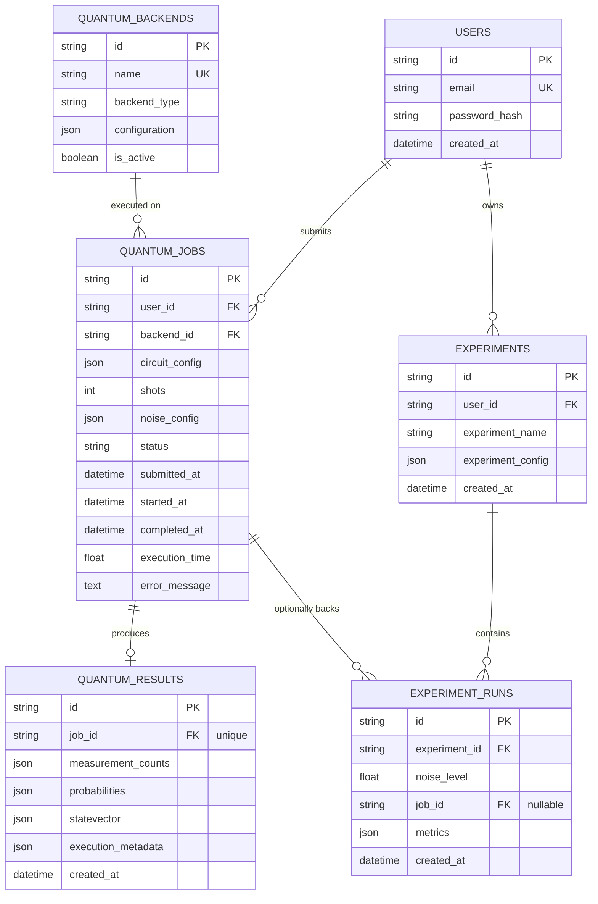

# DATABASE_DESIGN.md — QuantumCloud Data Model

Engine: PostgreSQL 16 in production/Docker; SQLite in local dev/tests
(schema is identical — SQLAlchemy/Alembic generate the same DDL shape
for both, verified by generating and applying the initial migration
against SQLite in this environment).

## 1. Entity-Relationship Diagram

## 2. Entity Detail

### `users`
| Field | Type | Constraints |
|---|---|---|
| `id` | `String` (UUID) | PK |
| `email` | `String` | Unique, indexed, not null |
| `password_hash` | `String` | Not null (bcrypt; never the raw password) |
| `created_at` | `DateTime` | Server default `now()` |

**Relational, not JSON** — fixed, small attribute set with strong
uniqueness/auth requirements.

### `quantum_backends`
| Field | Type | Constraints |
|---|---|---|
| `id` | `String` (UUID) | PK |
| `name` | `String` | Unique, not null |
| `backend_type` | `String` | Not null (`ideal_qasm`/`statevector`/`noisy`/`custom_noise`) |
| `configuration` | **JSON** | Free-form (currently just a description string) |
| `is_active` | `Boolean` | Default `true` |

`configuration` is JSON because it is backend-type-specific metadata
that is expected to grow (e.g., a future hardware backend's connection
details) without a schema migration for every new field.

### `quantum_jobs`
| Field | Type | Constraints |
|---|---|---|
| `id` | `String` (UUID) | PK, indexed |
| `user_id` | `String` | FK → `users.id`, indexed |
| `backend_id` | `String` | FK → `quantum_backends.id` |
| `circuit_config` | **JSON** | Not null — the exact submitted circuit |
| `shots` | `Integer` | Default 1024 |
| `noise_config` | **JSON**, nullable | Only present for noisy/custom_noise jobs |
| `status` | `Enum(JobStatus)` | Indexed; one of QUEUED/VALIDATING/RUNNING/COMPLETED/FAILED/CANCELLED |
| `submitted_at` | `DateTime` | Server default `now()` |
| `started_at` | `DateTime`, nullable | Set when a worker picks up the job |
| `completed_at` | `DateTime`, nullable | Set on COMPLETED or FAILED |
| `execution_time` | `Float`, nullable | Seconds; set on COMPLETED |
| `error_message` | `Text`, nullable | Set on FAILED |

`circuit_config` and `noise_config` are JSON because a circuit's shape
(variable qubit count, variable operation list) is not naturally
relational without an excessive number of join tables (an `operations`
table with polymorphic gate parameters would add real complexity for
no query benefit — nothing in this product queries "find all jobs that
used gate X," which would be the only reason to normalize this).
`status` is indexed because job listing/filtering by status (FR-JOB-004,
dashboard stats) is a primary access pattern.

### `quantum_results`
| Field | Type | Constraints |
|---|---|---|
| `id` | `String` (UUID) | PK |
| `job_id` | `String` | FK → `quantum_jobs.id`, **unique** (1:1), indexed |
| `measurement_counts` | **JSON**, nullable | Shot-based backends only |
| `probabilities` | **JSON**, nullable | All backends |
| `statevector` | **JSON**, nullable | Statevector backend only, **and only if `num_qubits ≤ MAX_STATEVECTOR_JSON_QUBITS (16)`** |
| `execution_metadata` | **JSON** | Backend name, timings, noise flag, qubit count |
| `created_at` | `DateTime` | Server default `now()` |

**Retention/size control:** the 16-qubit cap on persisted statevectors
is enforced in `app/workers/tasks.py` before the row is even
constructed — at 16 qubits, a statevector is 2¹⁶ = 65,536 complex
amplitudes (real+imag), which is already a large JSON array; beyond
that it is deliberately *not* persisted (the job still completes and
reports probabilities, just not the raw statevector) rather than
allowing unbounded row growth.

### `experiments`
| Field | Type | Constraints |
|---|---|---|
| `id` | `String` (UUID) | PK |
| `user_id` | `String` | FK → `users.id`, indexed |
| `experiment_name` | `String` | Not null |
| `experiment_config` | **JSON** | `{circuit, shots, noise_levels}` — the full sweep spec |
| `created_at` | `DateTime` | Server default `now()` |

### `experiment_runs`
| Field | Type | Constraints |
|---|---|---|
| `id` | `String` (UUID) | PK |
| `experiment_id` | `String` | FK → `experiments.id`, indexed |
| `noise_level` | `Float` | Not null |
| `job_id` | `String`, nullable | FK → `quantum_jobs.id` — reserved for a future design where each sweep point is also a first-class job; **currently always null**, since noise-sweep runs execute synchronously inline rather than through the job queue (see ROADMAP.md for the planned change) |
| `metrics` | **JSON** | `{measurement_counts, probabilities, observable_error, fidelity_proxy, execution_time_seconds}` |
| `created_at` | `DateTime` | Server default `now()` |

## 3. JSON vs. Relational — summary rule applied

A field is **JSON/JSONB** when: (a) its internal shape varies by row
(circuit operations, noise config, metrics) or by backend type
(`configuration`), and (b) no current product requirement needs to
query *inside* that structure at the database level (all filtering is
by `status`, `backend_id`, `user_id`, `experiment_id` — all of which
are normal relational columns). A field is **relational** when it is
fixed-shape and either a join key or a uniqueness/auth constraint
target (`email`, `backend_type`, all foreign keys, `status`).

If a future requirement needs "find all jobs using gate X" or "find
all experiments where noise_level > 0.05 and fidelity_proxy < 0.8" as
a server-side filter (not just client-side post-processing), that is
the trigger to either move to JSONB with a GIN index (Postgres-specific,
would require dropping SQLite dev/test support or branching the
migration) or to extract specific frequently-filtered fields into real
columns. Not needed today — flagged as a forward-looking decision
point, not made preemptively per the "avoid unrealistic/premature"
instruction in the PRD brief.

## 4. Indexing Summary

| Table | Indexed columns | Reason |
|---|---|---|
| `users` | `email` (unique) | Login lookup, uniqueness enforcement |
| `quantum_jobs` | `id`, `user_id`, `status` | Primary lookup, per-user listing, status filtering |
| `quantum_results` | `job_id` (unique) | 1:1 lookup from job |
| `experiments` | `user_id` | Per-user listing |
| `experiment_runs` | `experiment_id` | Fetch all runs for one experiment |

## 5. Migration

Initial schema migration: `backend/alembic/versions/be0a0dabd080_initial_schema.py`,
generated via `alembic revision --autogenerate` and verified by
applying it to a fresh SQLite database and confirming all 6 tables
(`users`, `quantum_backends`, `quantum_jobs`, `quantum_results`,
`experiments`, `experiment_runs`) plus Alembic's own `alembic_version`
table are created. **Not yet applied against a real PostgreSQL
instance** in this environment (no Postgres installed) — flagged
consistent with other Docker-dependent verification gaps in this
document set.
